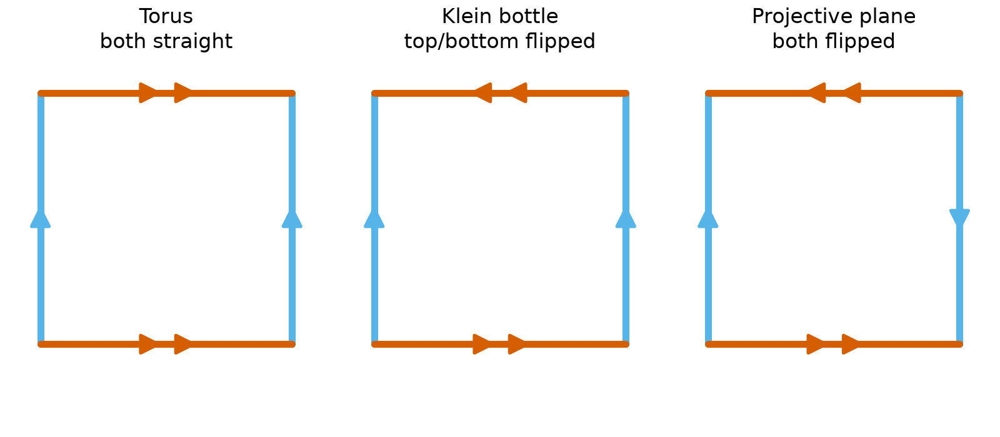
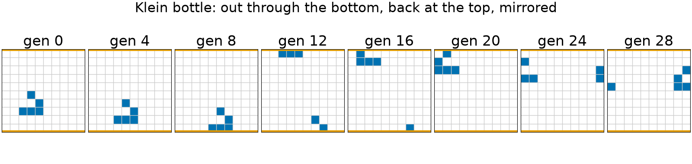
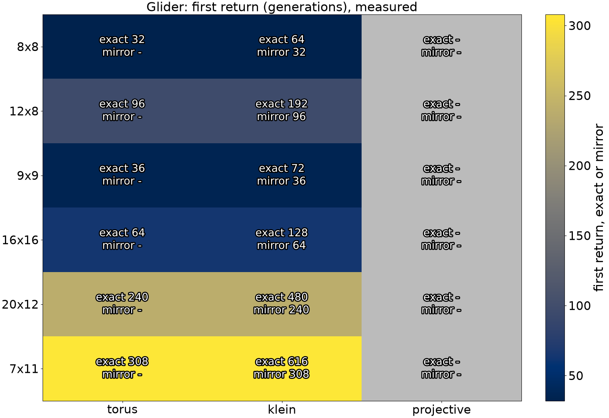
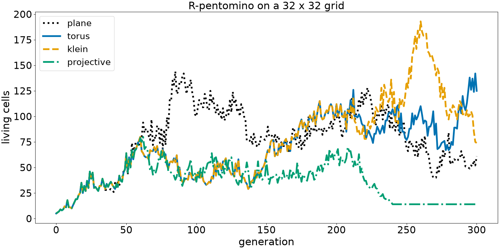
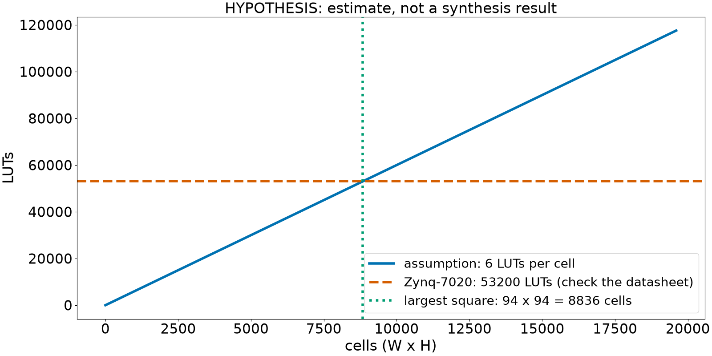

<!-- README.md -->
# TwistLife

Conway's Game of Life on a torus, a Klein bottle and a projective plane.

## What it is

TwistLife runs Conway's Game of Life on a grid whose edges are glued together, so the grid has no border. Depending on the gluing, the grid becomes a torus, a Klein bottle or a projective plane, and a glider that crosses a flipped edge comes back as its own mirror image. This repo contains a Python model, tests, figures and generated Verilog wiring files, as a first step towards running it on an FPGA (a chip whose logic you can rewire).

This is a CAS (IB Creativity) project. I build hardware projects and I own a PYNQ-Z2 board, but I have not run any of this on an FPGA yet.

## Honest status

**DONE**
- Python model: neighbour tables, a slow and a fast step function (rule B3/S23), patterns, a glider tracker.
- Tests in `tests/test_core.py` (7 checks; run them to see the result on your machine).
- Five figures in `figures/`, made by `run_demo.py`.
- Generated Verilog wiring and test vectors in `hardware/generated/`, plus `hardware/cell.v` and `hardware/life_grid.v`.

**NOT DONE**
- Nothing has been compiled or simulated in Verilog.
- Nothing has run on the FPGA.
- No speed or size has been measured. All hardware numbers are HYPOTHESIS.

**NEXT STEPS**
- Write a Verilog testbench and simulate it against the vectors with Icarus Verilog.
- Synthesize for the PYNQ-Z2 and read the real LUT count.
- Show the grid on HDMI and switch surfaces with the board switches.

Details are in [hardware/PLAN.md](hardware/PLAN.md).

## How to run

Python 3.10 or newer.

```
pip install numpy matplotlib
python emit_verilog.py && python run_demo.py
python tests/test_core.py
```

`run_demo.py` prints the glider table and the hardware estimate and saves both in `figures/`. The tests run last, so they also re-check the generated vector files.

## The math, at high-school level

**What gluing means.** Take a grid of cells. In old video games, when you walk off the right side you appear on the left side. That is gluing the left and right edges "straight". If you also glue top and bottom straight, you get a **torus**: the surface of a donut.

**Gluing with a flip.** Now imagine a paper strip. Before you glue its ends, you twist it half a turn. Something that walks across that seam comes back upside down. In the grid this means: leave through the bottom edge at column `x`, come back through the top at column `W-1-x`. One flipped pair and one straight pair gives a **Klein bottle**. Two flipped pairs give a **projective plane**. Figure 1 shows all three.

**Why a flip mirrors the glider.** A glider is a small shape of 5 cells that moves one cell diagonally every 4 generations. When it crosses the flipped edge, every one of its cells is sent from `x` to `W-1-x`. That is exactly a mirror. So the glider comes back as its mirror image, moving in the mirrored direction (Figure 2).

**Why a mirrored glider is still a glider.** Life's rule only counts living neighbours. It does not care whether a neighbour is on the left or the right. So if you mirror any pattern, its future is the mirror of the old future. A mirrored glider therefore still works as a glider. It just travels the other way.

**How the neighbour table is tested.** For every cell, the program lists its 8 neighbours. Think of it like a list of friends: if A lists B as a neighbour, then B must list A, and the same number of times. The test checks this for every surface and several grid sizes. A mistake in gluing the corners breaks this rule, so the test catches it.

**The corner choice on the projective plane.** On the projective plane, the four corners of the square are glued in pairs. So only two cells meet at each corner point, not four. Our rule sends the diagonal step across such a corner back to the cell itself. The symmetry test checks this and prints 4 corner cells for the tested grid sizes.

**Return times.** The glider table (Figure 3 and `figures/glider_table.txt`) is measured by simulation, not taken from a formula. Run the demo to see the numbers.

## Figures


*How the three surfaces are glued. Torus: both pairs straight. Klein bottle: top and bottom flipped. Projective plane: both pairs flipped.*


*A glider on a 10 x 10 Klein bottle, every 4 generations. After crossing the flipped edge it is its own mirror image.*


*Glider return times, measured by simulation. Grey means nothing was seen within the limit. The same numbers are in figures/glider_table.txt.*


*R-pentomino population on each surface. At first all lines agree, because the pattern has not reached an edge yet.*


*HYPOTHESIS, not a synthesis result: LUT estimate with a fixed number of LUTs per cell. Check the datasheet. Stage 3 of the plan will give real numbers.*

## Why hardware likes it (HYPOTHESIS)

- **Topology is only wiring.** Every cell runs the same small logic. The surface only decides which wire goes to which cell. Interior cells have the same neighbours on every surface. Only the `2W + 2H - 4` edge cells are different (60 cells on a 16 x 16 grid).
- **All cells update at once.** In hardware, every cell can compute its next state on the same clock tick. If that works, one generation takes one clock cycle. This is a HYPOTHESIS until Stage 2 and 3.
- **Simple counts.** A 16 x 16 grid has 256 cells, 2048 neighbour wires (8 per cell) and 256 bits of state (one flip-flop each, a flip-flop being a 1-bit memory cell).
- **Rough size.** A LUT is a small lookup table, the basic logic block of an FPGA. If one cell needs about 6 LUTs (an assumption, `luts_per_cell` in `CONFIG`), then 53,200 LUTs give room for about 94 x 94 = 8,836 cells. The Zynq-7020 numbers come from my notes; check the datasheet. The real count comes from synthesis in Stage 3.

## Project layout

```
twistlife/core.py       model, patterns, glider tracker, hardware estimate, vectors
tests/test_core.py      tests, one line of output per test
run_demo.py             glider table + 5 figures
emit_verilog.py         writes hardware/generated/*, hardware/cell.v, hardware/life_grid.v
hardware/PLAN.md        the hardware plan, stage by stage
```

## AI use

I leveraged an AI assistant for specific sections of the code; however, the overall architecture, testing, and decision-making were led by me.

## Novelty

I did not do a literature search, so I make no claim that this is new.

## License

MIT, see [LICENSE](LICENSE). Author: ziydin.
